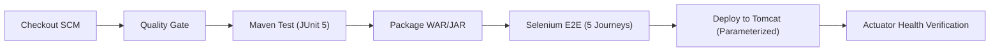

# 🚀 Jenkins CI/CD & Parameterized Apache Tomcat Deployment Guide (Tasks 7–8)

This guide documents the Jenkins Declarative Pipeline job, parameter definitions, stage lifecycle, and automated Tomcat deployment.

---

## 1. 📋 Parameterized Settings

The pipeline provides three parameterized settings configured via `Jenkinsfile` and `jenkins/job_config.xml`:

| Parameter | Type | Default Value | Description |
|---|---|---|---|
| `ENVIRONMENT` | Choice (`staging`, `production`, `dev`) | `staging` | Target execution environment. Determines server path and notification targets. |
| `TOMCAT_PORT` | String | `8080` | Port for the Apache Tomcat HTTP connector. |
| `DEPLOY_CONTEXT` | String | `wellness` | Context path for the deployed application (e.g. `http://localhost:8080/wellness`). |
| `RUN_SELENIUM_E2E` | Boolean | `true` | Conditional flag to toggle headless Selenium regression journeys. |

---

## 2. 🔄 Pipeline Stages Architecture



1. **Checkout SCM**: Fetches source code from GitHub with clean workspace wiping.
2. **Code Quality**: Validates branch policies and commit messages.
3. **Maven Compile & Unit Tests**: Runs unit test assertions with test report generation.
4. **Package Application Artifact**: Creates production-ready artifact and archives it in Jenkins.
5. **Selenium E2E Test Journeys**: Executes automated headless journeys through Maven Surefire.
6. **Deploy to Apache Tomcat (Parameterized)**: Dispatches parameterized payload to `scripts/deploy-tomcat.sh` or `scripts/deploy-tomcat.ps1`.
7. **Health Check & Telemetry Verification**: Calls `/actuator/health` and confirms HTTP 200 with status `"UP"`.

---

## 3. 🖥️ How to Import into Jenkins

### Via Jenkins CLI:
```bash
java -jar jenkins-cli.jar -s http://localhost:8080/ create-job corporate-wellness-dashboard < jenkins/job_config.xml
```

### Via Jenkins REST API:
```bash
curl -X POST "http://localhost:8080/createItem?name=corporate-wellness-dashboard" \
     --user "admin:your-api-token" \
     --header "Content-Type: application/xml" \
     --data-binary "@jenkins/job_config.xml"
```
